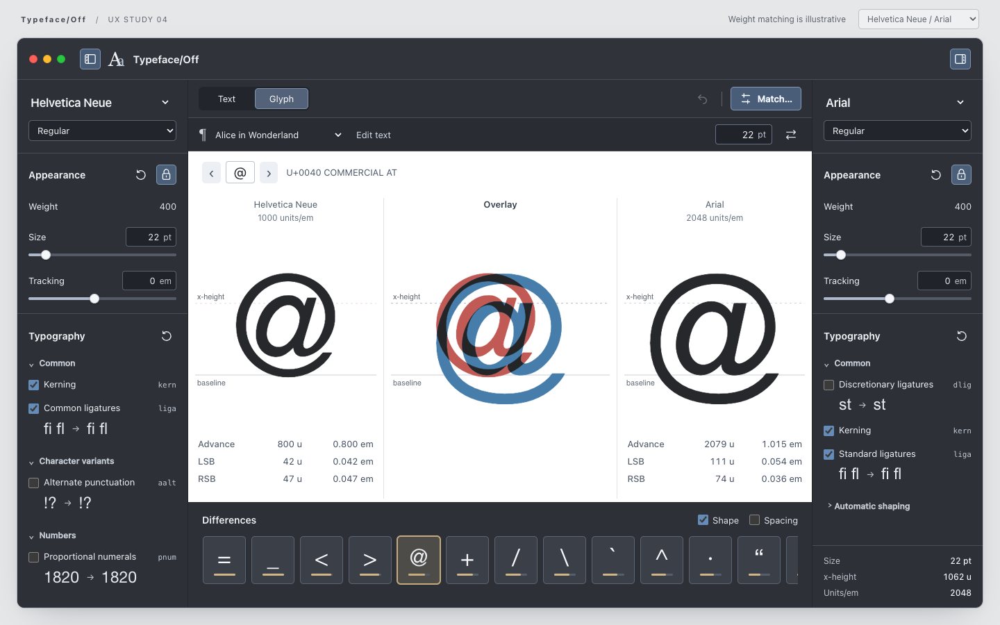

# Typeface/Off

A macOS typeface comparison workbench, starting with an interactive UX study.

```sh
python3 mockups/server.py
```

Open [the mockup](http://127.0.0.1:8765). It uses locally installed fonts; no dependencies or downloads are required.

Compare text, inspect large glyphs and red/blue/black overlays, link or separate appearance adjustments, preview matching suggestions, and explore OpenType features. Glyph metrics show native font units and em; the glyph view keeps a fixed baseline while browsing characters. Reading samples use Lewis Carroll. The current prototype runs in a browser; difference rankings use measured glyph shapes and spacing. Weight suggestions remain illustrative.

[Interaction guide and implementation notes](mockups/README.md) · [Review screenshots](mockups/README.md#review-screens)


